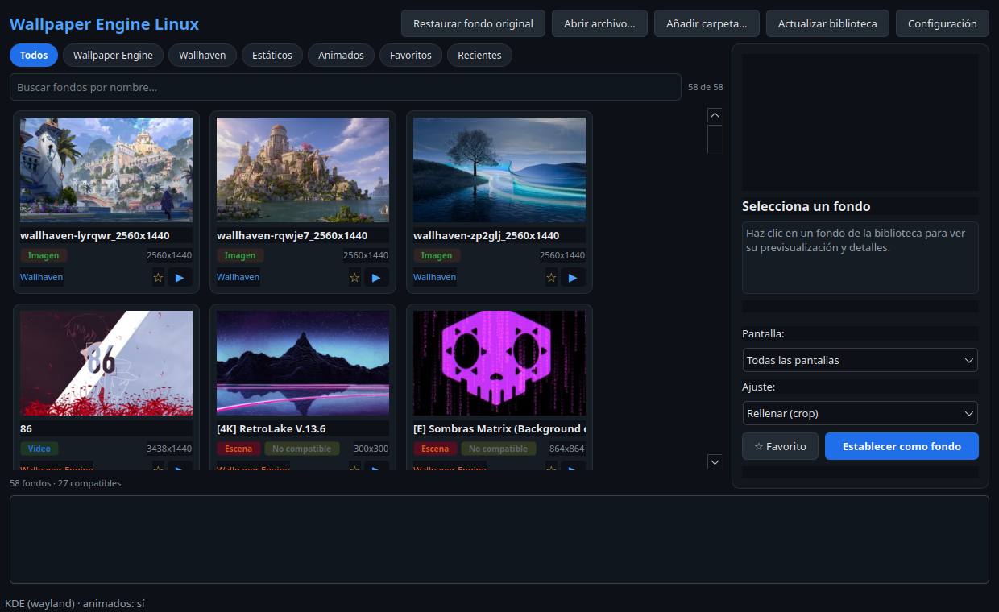
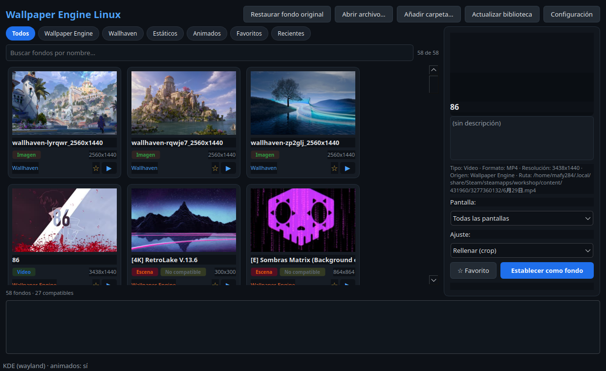
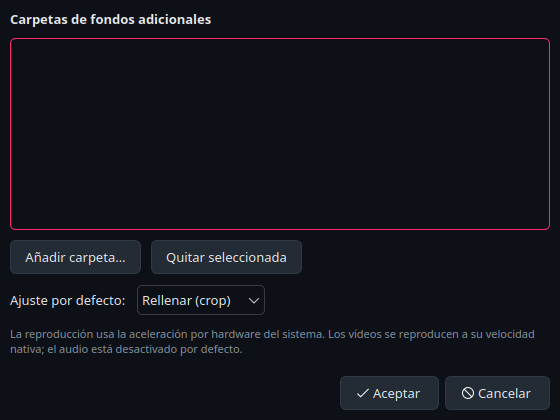

# Wallpaper Engine Linux

Aplicación local para Ubuntu (KDE Plasma / GNOME) que gestiona y reproduce
fondos de pantalla estáticos y animados usando tus bibliotecas existentes de
Wallpaper Engine (Steam Workshop) y Wallhaven, sin servicios permanentes y con
restauración automática del fondo original al cerrar.

## Estado

- ✅ Fase 1: Investigación y arquitectura — `docs/01-informe-tecnico.md`
- ✅ Fase 2: Prototipo funcional (plugin de Plasma + daemon C)
- ✅ Fase 3: Bibliotecas (Steam/WE + Wallhaven, índice, miniaturas)
- ✅ Fase 4: Motor de reproducción (vídeos, GIF, HTML5, hw-accel)
- ✅ Fase 5: Interfaz completa (categorías, favoritos, detalles, ajustes)
- ✅ Fase 6: Integración Ubuntu (.desktop, icono, instalador)
- 🔄 Fase 7: Pruebas y optimización

## Capturas de pantalla

| Biblioteca | Panel de detalles | Configuración |
|---|---|---|
|  |  |  |

## Instalación rápida

| Distro | Método |
|---|---|
| **Ubuntu / Debian** | Descarga el `.deb` de [Releases](https://github.com/MAFY284/wallpaper-engine-linux/releases) y `sudo apt install ./wallpaper-engine-linux_*.deb` |
| **Arch Linux** | `makepkg -si` con el `PKGBUILD` de [Releases](https://github.com/MAFY284/wallpaper-engine-linux/releases) (o `packaging/arch/PKGBUILD`) |
| **Otras** | Clona el repo y ejecuta `./tools/install.sh` (detecta la distro e indica dependencias) |

Ver `docs/INSTALACION.md` para los requisitos completos y `docs/USO.md` para
la guía de uso y límites conocidos.

## Estructura

```
app/      GUI Python (PySide6) — interfaz, biblioteca, importadores, integración
core/     Daemon nativo C — capa de fondo (Wayland layer-shell) + libmpv
desktop/  Plugin de Plasma (wel.video), archivo .desktop, icono SVG
bin/      Lanzadores y binarios
tools/    Instalador, desinstalador y herramientas de desarrollo
docs/     Documentación
```

## Documentación

- Informe técnico y arquitectura: `docs/01-informe-tecnico.md`
- Instalación: `docs/INSTALACION.md`
- Uso: `docs/USO.md`
- Registro de tareas y decisiones: `TASKS.md`
